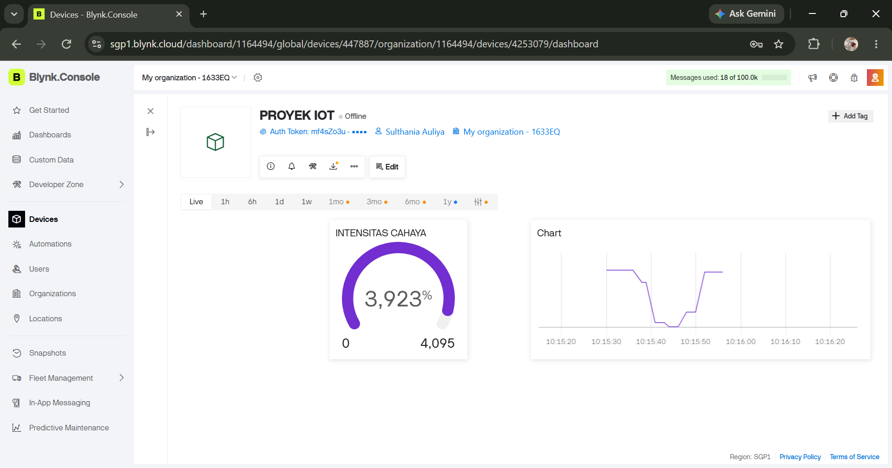

# Light Intensity Monitoring (ESP32 + LDR + Blynk Cloud, simulated in Wokwi)

An ESP32 reads a light sensor (LDR) in the **Wokwi** simulator and sends the value to a **Blynk Cloud** web dashboard in real time through Virtual Pin V0. Made for the Internet of Things course (Task 4 demo).

## Components
| Component | Function |
|---|---|
| ESP32 (Wokwi) | Reads the sensor and sends data to Blynk over Wi-Fi |
| LDR (photoresistor) module | Measures light intensity (analog input, GPIO 34) |
| Blynk Template + Datastream V0 | Bridge between the code and the dashboard |
| Gauge + Chart widgets | Show the latest value and the history |

## Blynk setup
1. Create a template (Hardware: ESP32, Connection: Wi-Fi).
2. Add a Datastream: Virtual Pin **V0**, Integer, min 0, max 4095 (ESP32 ADC is 12-bit).
3. Web Dashboard tab: add a **Gauge** and a **Chart**, both bound to V0, then Save.
4. Create a Device from the template and copy the Template ID, Template Name and Auth Token.

## How It Works
1. `setup()` connects the ESP32 to the virtual Wi-Fi (`Wokwi-GUEST`) and to Blynk Cloud.
2. A `BlynkTimer` calls `sendSensor()` every 1 second.
3. `sendSensor()` reads `analogRead(34)` (0 - 4095), prints it to the Serial Monitor and sends it to V0 with `Blynk.virtualWrite`.
4. The Gauge and Chart on the dashboard update automatically.

## Code
[`blynk_ldr_monitor/blynk_ldr_monitor.ino`](blynk_ldr_monitor/blynk_ldr_monitor.ino)

Library: `Blynk` (install it in the Wokwi Library Manager, see `blynk_ldr_monitor/libraries.txt`).

> **Security:** the Auth Token in the sketch is a placeholder. Put your own token in only when you run the simulation, and never commit it.

## Run It
1. Open a new ESP32 project in Wokwi and add an LDR module on GPIO 34.
2. Paste the sketch and fill in your Auth Token.
3. Start the simulation, then move the light slider and watch the dashboard change.

## Possible Improvements
- Add notifications or automatic lamp control based on a light threshold.
- Move to a physical ESP32 + LDR to test real-world reliability.

## Authors
Amira Najihah Fadri Putri, Mareta Surya Tananjaya, Novasya Aulia Putri Hidayat, Sulthania Auliya Afandi (Kelompok 3)

## Report
Full report: [`docs/Kel3_DemoTugas4.pdf`](docs/Kel3_DemoTugas4.pdf)

Demo video: https://drive.google.com/file/d/1d0Ba5Oi-AQRBzfwsyyiOyVTA_zA5AHcB/view?usp=sharing
